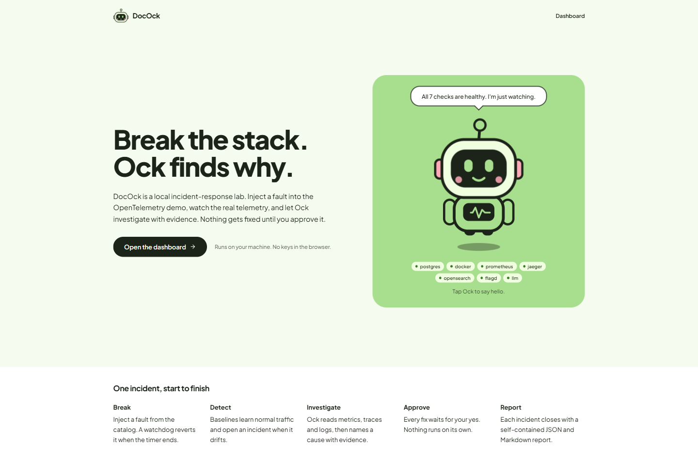
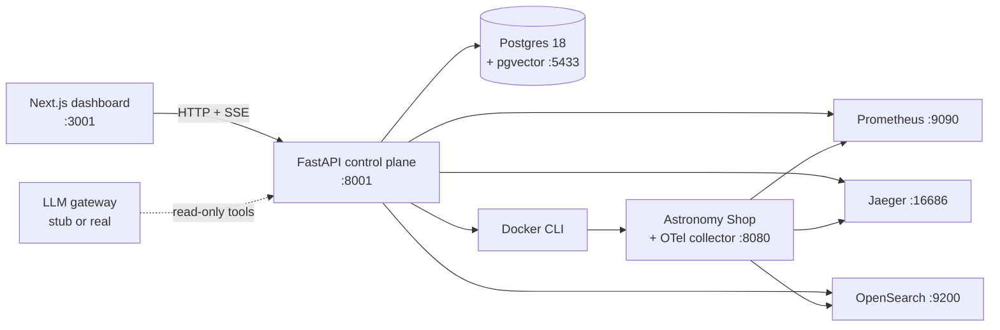

<div align="center">


# DocOck

**Break the stack. Ock finds why.**

A local, end-to-end incident-response lab built on the OpenTelemetry Astronomy Shop.
Inject a real fault, watch real telemetry, get an evidence-backed diagnosis, approve a
bounded fix, and verify recovery — all on your own machine.

[](https://www.python.org/)
[](https://fastapi.tiangolo.com/)
[](https://nextjs.org/)
[](https://github.com/pgvector/pgvector)
[](https://opentelemetry.io/)
[](LICENSE)

[Quick start](#quick-start) · [How it works](#the-loop) · [Manual setup](#manual-setup) · [Commands](#runner-reference) · [Docs](#documentation)

</div>



---

## Why DocOck

Most "AI on-call" demos stop at a chat reply. DocOck runs the whole loop against a live
25-container microservice stack and proves the result:

- **Real faults, real symptoms.** 25 reversible faults — 14 flagd application faults and
  11 infrastructure faults (stop, SIGKILL crash, pause, network partition, CPU/memory
  limits, OOM crash loop, load spike, and outages of the Valkey cache and catalog
  Postgres) — with a TTL and a watchdog that reverts them even if nothing else is alive.
- **Fixes problems it did not cause.** A drift scanner compares the live lab with a
  learned *desired state* (containers running and attached, limits, network aliases,
  flags, load). Remediation reconciles that drift, so a container stopped by hand, a
  flag flipped in flagd-ui or a `docker update` from a shell is fixed the same way as an
  injected fault — no fault record needed.
- **Fully autonomous, mostly deterministic.** The autopilot drives every incident:
  investigate → choose a fix → auto-approve within a risk policy → execute → verify →
  try the next candidate if verification fails → escalate only when the ladder is
  exhausted. Python builds the candidate ladder, checks preconditions, mints the
  single-use token, executes and verifies; the LLM diagnoses (read-only tools), picks the
  next rung from the ladder and explains why. It never gets Docker or shell access and
  cannot invent an action.
- **Human approval is one switch away.** `AUTOPILOT_ENABLED=false` (or a lower
  `AUTOPILOT_MAX_RISK`) puts every action back behind a pending approval with a
  single-use, short-lived token; replayed tokens are refused.
- **Proof, not vibes.** Recovery is verified against the same signals that detected the
  incident plus "desired state restored", and every incident closes with a JSON +
  Markdown report containing the timeline, citations, before/after metrics and audit
  trail.

It runs offline by default with a deterministic `stub` model. A real provider is one
environment variable away.

---

## The loop

| Stage | What happens | Decided by |
|---|---|---|
| **Break** | Inject a fault from the Fault Lab, or break the lab any other way (`docker stop`, flagd-ui, `docker update`). | You |
| **Detect** | Baselines learn normal traffic per service; sustained breaches open one incident. | Python |
| **Investigate** | Read-only tools pull metrics, traces, logs, container state and drift; suspects are ranked with evidence codes (`E0001`…). | Python + LLM |
| **Choose** | A deterministic ladder lists every fix worth trying (diagnosis, related drift, recorded faults, restart, reconcile-all); the LLM picks one and explains it. | Python + LLM |
| **Approve** | Autopilot approves actions up to `AUTOPILOT_MAX_RISK`; anything above waits for a human. | Policy / you |
| **Execute** | The executor consumes the single-use token, reverts recorded faults with their pre-image, then reconciles remaining drift in the action's scope. | Python |
| **Verify** | Symptoms clear, desired state restored, fault/flag/container checks over 4 clean cycles. | Python |
| **Retry** | A failed verification proposes the next rung (up to `AUTOPILOT_MAX_ATTEMPTS`) instead of giving up. | Python + LLM |
| **Report** | Self-contained JSON/Markdown report with timeline, cited evidence, every attempt and before → after metrics. | Python |

When the ladder is exhausted the incident is escalated and the report shows each attempt
and exactly which criteria failed.

---

## Quick start

### Prerequisites

| Tool | Version | Check |
|---|---|---|
| Docker Desktop / Engine | Compose v2 | `docker compose version` |
| Python | 3.11 (managed by `uv`) | `uv --version` |
| Node.js + pnpm | 22+ / 11+ | `node --version && pnpm --version` |
| Git | any recent | `git --version` |
| Git Bash | only on Windows | `"C:\Program Files\Git\bin\bash.exe" --version` |
| Free disk | ~12 GB for images + models | `docker system df` |

Give Docker Desktop at least 4 GB of memory (8 GB is comfortable). The demo alone runs
about 20 containers plus OpenSearch; measured on a 16 GB / 4-core host the whole stack
uses about 3.7 GB of RAM and ~13 GB of images.

**Small or locked-down host?** (16 GB laptop, CI runner, cloud sandbox, rootless Docker,
WSL without IPv6, a TLS-intercepting proxy) add `--constrained`. It layers
[`infra/compose/constrained.override.yaml`](infra/compose/constrained.override.yaml):
no memlock ulimit for OpenSearch, IPv4-only listeners for the nginx images and flagd-ui,
a nofile limit the host allows, and no Grafana plugin download. Nothing DocOck measures
changes. To save another ~600 MB of disk, set `EMBEDDING_PROVIDER=stub` in `.env`.

### One command

```bash
git clone https://github.com/sankalphs/DocOck.git
cd DocOck
./run.sh
```

On Windows, use the PowerShell wrapper (it finds Git Bash for you):

```powershell
git clone https://github.com/sankalphs/DocOck.git
cd DocOck
.\run.ps1
```

The runner does the boring parts in order:

1. checks Docker, `uv`, Node, pnpm and free ports;
2. creates `.env` from `.env.example` if it is missing;
3. clones the OpenTelemetry demo at the pinned commit;
4. seeds the runtime flagd file and starts both Compose projects;
5. waits for Prometheus, Jaeger, OpenSearch, flagd, the storefront and Postgres;
6. runs `uv sync`, applies Alembic migrations and `pnpm install`;
7. starts the API on `:8001` and the dashboard on `:3001`, then waits for both.

Open **<http://127.0.0.1:3001>** and press **Open the dashboard**.

> **First run:** images are several GB and can take 10–20 minutes. The detector also
> needs a **300 s warm-up** before it will open an incident. The default `stub` model is
> offline and needs no API key.

Stop the API and dashboard with `Ctrl-C` (the containers keep running), or stop
everything with:

```bash
./run.sh --stop            # apps + containers, keep Postgres data
./run.sh --stop --volumes  # also delete the Postgres volume
./run.sh --purge           # also remove every image used by the lab (~10 GB re-pull)
```

---

## Runner reference

`run.sh` is safe to re-run: it stops the previous API/dashboard it started, brings the
stack back to the same state, and reuses existing images and data.

| Command | What it does |
|---|---|
| `./run.sh` | Setup + start everything, keep logs in the foreground |
| `./run.sh --detach` | Start in the background and return to the prompt |
| `./run.sh --skip-pull` | Skip the image pull on later runs |
| `./run.sh --no-wait` | Do not block on telemetry health checks |
| `./run.sh --skip-stack` | Assume Docker is already up; only start the apps |
| `./run.sh --no-dashboard` | Start the API only |
| `./run.sh --no-api` | Start the dashboard only |
| `./run.sh --fresh` | Delete and re-clone the pinned demo checkout |
| `./run.sh --reseed-flags` | Restore `runtime/flagd/demo.flagd.json` from upstream |
| `./run.sh --constrained` | Small/locked-down host profile (also `DOCOCK_CONSTRAINED=1`) |
| `./run.sh --wait 600` | Give the first Docker start more time |
| `./run.sh --stop` | Stop apps and both Compose projects, keep data |
| `./run.sh --stop --volumes` | Also delete the Postgres volume |
| `./run.sh --purge` | Stop and delete containers, networks, volumes and project images |
| `./run.sh --logs` | Follow `runtime/api.log` and `runtime/dashboard.log` |
| `./run.sh --check` | Run the full quality gate without Docker |

Run `./run.sh --help` for the same list. Logs live in `runtime/`; PID files in
`runtime/run/`.

---

## Manual setup

The runner is the supported path. These are the underlying steps if you want to run
pieces yourself. On Windows the original PowerShell scripts remain available
(`scripts\up.ps1`, `scripts\down.ps1`, `scripts\health.ps1`, `scripts\check.ps1`).

### 1. Configuration

```bash
cp .env.example .env
```

Every value has a local default. `.env` is git-ignored; never commit it. The offline
defaults need no key:

```dotenv
LLM_PROVIDER=stub
EMBEDDING_PROVIDER=onnx_local
```

### 2. Docker stack

Start just the two Compose projects and return:

```bash
./run.sh --no-api --no-dashboard
```

The runner validates ports, creates `.env`, clones the pinned demo checkout, seeds the
flag file and starts both projects. The two Compose projects are:

| Project | Contents | Definition |
|---|---|---|
| `docock-demo` | Astronomy Shop, flagd, Prometheus, Jaeger, OpenSearch, Grafana | upstream demo + `infra/compose/lab.override.yaml` |
| `docock-lab` | Postgres 18 + pgvector | `infra/compose/base.yaml` |

The demo checkout is pinned by `infra/otel-demo.lock.json` and is not committed.

### 3. API

```bash
cd apps/api
uv sync --frozen
uv run alembic upgrade head
uv run uvicorn app.main:app --reload --host 127.0.0.1 --port 8001
```

API docs: <http://127.0.0.1:8001/docs>.

### 4. Dashboard

```bash
cd apps/dashboard
pnpm install --frozen-lockfile
pnpm dev
```

Dashboard: <http://127.0.0.1:3001>. The typed API client is generated from the running
API with `pnpm gen:api`; commit the regenerated `lib/api/schema.d.ts`.

### 5. Health

```bash
./run.sh --logs          # or:
curl http://127.0.0.1:8001/api/health
```

The API's `/api/health` probes every dependency for real. A broken dependency is visible
before you inject anything.

---

## Using the lab

A complete walkthrough with timings and talking points is in
[`docs/DEMO.md`](docs/DEMO.md). The short version:

1. Open **Fault Lab** → **Payment failure** → **100%** → **Inject** — or break something
   behind DocOck's back, e.g. `docker stop email`.
2. Within about 30–120 s the **Incidents** page opens one incident with the breached
   signals.
3. Do nothing. After `AUTOPILOT_INVESTIGATE_DELAY_S` the agent investigates; the
   **Approvals** page shows the autopilot panel (live drift + decisions) and each attempt
   with its rationale, auto-approved within policy.
4. Watch **Reports**: `REMEDIATING → VERIFYING → RESOLVED`, with before/after metrics and
   a downloadable Markdown report. If the first fix does not verify, the next candidate
   runs automatically.
5. Finish with **Fault Lab → Reset all** and confirm no incident is open.

Prefer to decide yourself? Set `AUTOPILOT_ENABLED=false`, restart the API, and use
**Agent → Investigate** and **Approvals → Dry-run → Approve** by hand. The wrong action
(`restart_service` on `payment` for a flag fault) then fails verification and escalates
after the 420 s window.

Check the loop end to end without touching anything:

```bash
apps/api/.venv/bin/python scripts/autopilot-e2e.py fault:payment_failure manual:stop:email \
  fault:cache_outage fault:oom_crash_loop@quote multi:fault:service_crash@shipping+manual:pause:ad
```

Out-of-band breaks (no fault row, so only drift can explain them): `manual:stop|pause|kill:<c>`,
`manual:disconnect:<c>` (leave the demo network), `manual:cpu:<c>=<cores>` (`docker update`),
`manual:flag:<flag>=<variant>` (edit the flagd file). `multi:a+b+c` breaks several at once; the
script follows every incident the break opens and passes only when all are resolved and no
drift is left.

---

## Configuration

All settings live in [`.env.example`](.env.example); the important ones:

| Variable | Default | Effect |
|---|---|---|
| `LLM_PROVIDER` | `stub` | `stub` \| `zenmux` \| `openai_compatible` |
| `LLM_API_KEY` | empty | Required only for a real provider; stays in `.env` |
| `LLM_MODEL` | `meta/muse-spark-1.3-contributor` | Any chat model the provider serves |
| `LLM_DAILY_BUDGET_USD` | `2.00` | Local cost accounting cap |
| `EMBEDDING_PROVIDER` | `onnx_local` | `onnx_local` (CPU) \| `remote` \| `stub` |
| `EMBEDDING_ALLOW_DOWNLOAD` | `true` | First ONNX use downloads ~614 MB into `runtime/models/` |
| `DETECTOR_INTERVAL_S` | `10` | Detection cadence; collector flushes every 10 s |
| `DETECTOR_BASELINE_WINDOW_S` | `900` | How much normal traffic the baseline learns |
| `FAULT_DEFAULT_TTL_S` | `900` | Default auto-revert timer |
| `FAULT_WATCHDOG_ENABLED` | `true` | Reverts expired faults even across an API restart |
| `AUTOPILOT_ENABLED` | `true` | Run investigate → fix → verify → retry with no human |
| `AUTOPILOT_MAX_RISK` | `high` | Highest action risk the autopilot approves (`none`/`low`/`medium`/`high`); above it waits for a human |
| `AUTOPILOT_MAX_ATTEMPTS` | `4` | Remediation attempts per incident before escalating |
| `AUTOPILOT_LLM_PLANNER` | `true` | Let a real model pick and explain the next fix (the stub always uses the deterministic order) |
| `AGENT_AUTO_REMEDIATE` | `false` | Legacy: with the autopilot off, auto-approve only `auto` (low-risk) actions |
| `RATE_LIMIT_ENABLED` | `true` | Per-client write limits; reads are never limited |

To use a real model, set `LLM_PROVIDER`, `LLM_MODEL` and `LLM_API_KEY` in `.env`, restart
the API, then test the connection:

```bash
curl -X POST -H "content-type: application/json" \
  -d '{"target":"all"}' http://127.0.0.1:8001/api/settings/models/test
```

Provider base URLs and keys are `.env`-only; the runtime settings API cannot change them.

---

## Architecture



**Trust boundary.** The browser has no Docker socket, no telemetry connection and no model
key. The API is the only process that reads infrastructure, and the only one that writes
to it. The LLM sees tool results and proposes actions from a fixed catalog; approval
tokens, allowlisted targets, the executor and the verifier are all deterministic Python.

The full contracts (metric names, Jaeger parameters, log fields, freshness) and the safety
boundary are in [`docs/ARCHITECTURE.md`](docs/ARCHITECTURE.md).

---

## Project layout

| Path | What |
|---|---|
| `apps/api` | FastAPI control plane, SQLAlchemy 2 async models, Alembic migrations |
| `apps/dashboard` | Next.js App Router dashboard (Tailwind v4, shadcn/ui, Recharts) |
| `infra/compose` | Two Compose projects: `docock-demo` and `docock-lab` |
| `infra/otel-collector` | Collector "extras" that lower span-metric flush to 10 s |
| `scripts` | PowerShell setup/quality scripts and live verification utilities |
| `run.sh` / `run.ps1` | One-command setup and lifecycle runner |
| `docs` | Plan, ADRs, runbook, demo script, phase evidence |
| `opentelemetry-demo/` | Pinned upstream checkout — git-ignored |

---

## Quality gate

```bash
./run.sh --check
```

This runs, in order:

- **API:** `ruff check`, `ruff format --check`, `mypy`, `pytest` (226 tests, no Docker needed)
- **Dashboard:** `eslint`, `vitest` (59 tests), `next build` (type-checks + production build)

The PowerShell equivalent is `scripts\check.ps1` (`-ApiOnly` skips the dashboard,
`-Live` adds the live telemetry contract tests).

### Full evaluation

With the stack and API up and no open incident:

```powershell
scripts\eval.ps1                 # Windows: S1–S8 + W1, full loop incl. remediation (~2 h)
scripts\eval.ps1 -Only S1,S5,W1  # subset
```

```bash
pwsh scripts/eval.ps1            # PowerShell 7 on macOS/Linux, same flags
```

It writes `runtime/eval.json`, `runtime/scoreboard.md` and
`runtime/secret-audit.json`, and exits 0 only when the scenario gate and secret audit
both pass. The committed evidence:

- **9/9 scenarios pass every check** on the deterministic stub and again on a real
  ZenMux model — top-1 9/9, agent 9/9, remediation 9/9.
- Verified recoveries on 8 scenarios; the deliberately wrong action fails verification
  and escalates, as designed.
- Secret audit: 0 findings.
- Detection p50 ≈ 98 s, agent latency p50 ≈ 4–12 s.

See [`docs/evidence/postp16-scoreboard.md`](docs/evidence/postp16-scoreboard.md) and
[`docs/PROGRESS.md`](docs/PROGRESS.md) for the numbers and the evidence behind them.

---

## Troubleshooting

| Symptom | Fix |
|---|---|
| `run.sh` reports a port conflict | `./run.sh --stop`, then check `docker ps` and any local process on 8080/9090/5433 |
| OpenSearch never turns green | It is the slowest dependency (60–120 s). Check `docker logs opensearch`; give Docker more memory |
| Jaeger UI 404s | Jaeger v2 serves under `JAEGER_BASE_PATH=/jaeger/ui`; align it with the demo checkout |
| Flag changes do not take effect | flagd rejects a UTF-8 BOM and ignores a file whose mtime moved backwards. `./run.sh --reseed-flags`, then restart flagd |
| API returns 503 / DB errors | `docker logs docock-postgres`; then `./run.sh --stop` and retry |
| Metrics look stale | The collector flushes every 10 s; a 2 m query window is the smallest useful one |
| Everything is wedged | `./run.sh --purge` then `./run.sh` (re-pulls images and drops Postgres data) |
| Need detail | [`docs/RUNBOOK.md`](docs/RUNBOOK.md) has the long-form fixes |

Logs: `runtime/api.log`, `runtime/dashboard.log`, `docker compose -p docock-demo logs`.

---

## Documentation

| Document | Contents |
|---|---|
| [`docs/DEMO.md`](docs/DEMO.md) | 15–20 minute walkthrough for an audience |
| [`docs/RUNBOOK.md`](docs/RUNBOOK.md) | Setup, operations, evaluation and troubleshooting |
| [`docs/ARCHITECTURE.md`](docs/ARCHITECTURE.md) | Trust boundary, telemetry contracts, fault and remediation design |
| [`docs/PROGRESS.md`](docs/PROGRESS.md) | Phase status and verification evidence |
| [`docs/PLAN.md`](docs/PLAN.md) | Original implementation plan and non-goals |
| [`docs/ADR/`](docs/ADR/) | Architecture decision records |

---

## License

[MIT](LICENSE). The OpenTelemetry demo is a separate upstream project and keeps its own
license; DocOck only pins a checkout at the commit recorded in
`infra/otel-demo.lock.json`.
