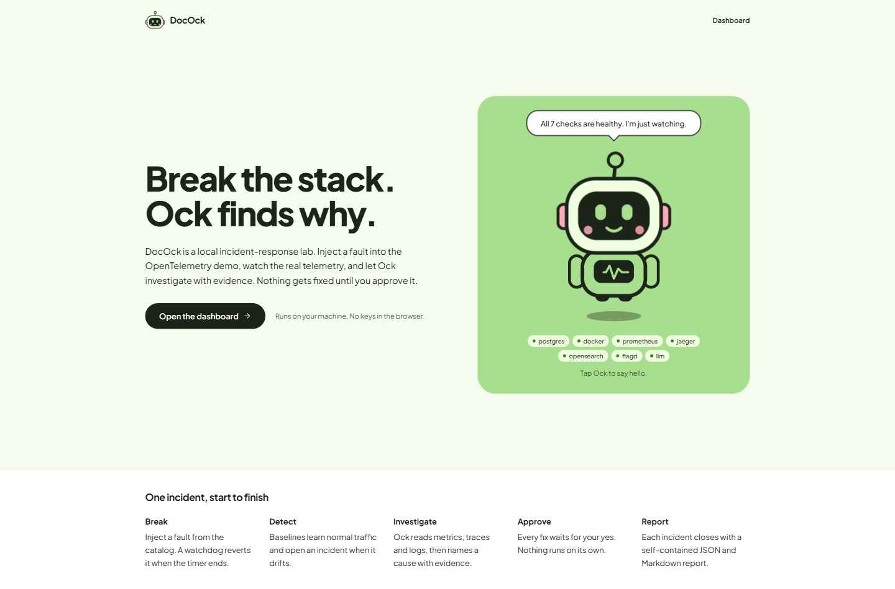
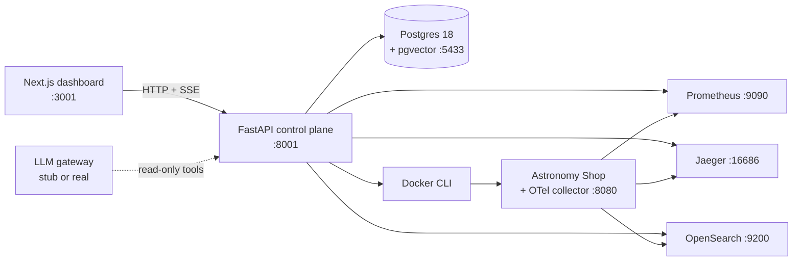

<div align="center">


# DocOck

**Break the stack. Ock finds why.**

A local, end-to-end incident-response lab built on the OpenTelemetry Astronomy Shop.
Inject a real fault, watch real telemetry, get an evidence-backed diagnosis, approve a
bounded fix, and verify recovery — all on your own machine.

[](https://www.python.org/)
[](https://fastapi.tiangolo.com/)
[](https://nextjs.org/)
[](https://github.com/pgvector/pgvector)
[](https://opentelemetry.io/)
[](LICENSE)

[Quick start](#quick-start) · [How it works](#the-loop) · [Manual setup](#manual-setup) · [Commands](#runner-reference) · [Docs](#documentation)

</div>



---

## Why DocOck

Most "AI on-call" demos stop at a chat reply. DocOck runs the whole loop against a live
25-container microservice stack and proves the result:

- **Real faults, real symptoms.** 19 reversible faults — 13 flagd application faults and
  6 infrastructure faults — with a TTL and a watchdog that reverts them even if nothing
  else is alive.
- **Deterministic where it matters.** Python owns detection, evidence, ranking, approval
  tokens, execution and verification. The LLM only gets read-only tools and a fixed action
  catalog; it never gets Docker or shell access.
- **Nothing runs without a human.** A diagnosis becomes a pending approval. Approving it
  issues a single-use, short-lived token bound to that exact action; replayed tokens are
  refused.
- **Proof, not vibes.** Recovery is verified against the same signals that detected the
  incident, and every incident closes with a JSON + Markdown report containing the
  timeline, citations, before/after metrics and audit trail.

It runs offline by default with a deterministic `stub` model. A real provider is one
environment variable away.

---

## The loop

| Stage | What happens | Decided by |
|---|---|---|
| **Break** | Pick a fault in the Fault Lab, dry-run it, inject it with a TTL. | You |
| **Detect** | Baselines learn normal traffic per service; sustained breaches open one incident. | Python |
| **Investigate** | Read-only tools pull metrics, traces, logs and container state; suspects are ranked with evidence codes (`E0001`…). | Python + LLM |
| **Approve** | The recommended action waits for a human. Dry-run, approve or reject with a note. | You |
| **Verify** | The verifier checks symptoms, the fault row, the flag and container health over 4 clean cycles. | Python |
| **Report** | Self-contained JSON/Markdown report with timeline, cited evidence and before → after metrics. | Python |

If verification fails, the incident is escalated and the report shows exactly which
criteria failed. That unhappy path is a first-class scenario (`W1`), not an edge case.

---

## Quick start

### Prerequisites

| Tool | Version | Check |
|---|---|---|
| Docker Desktop / Engine | Compose v2 | `docker compose version` |
| Python | 3.11 (managed by `uv`) | `uv --version` |
| Node.js + pnpm | 22+ / 11+ | `node --version && pnpm --version` |
| Git | any recent | `git --version` |
| Git Bash | only on Windows | `"C:\Program Files\Git\bin\bash.exe" --version` |
| Free disk | ~12 GB for images + models | `docker system df` |

Give Docker Desktop at least 4 GB of memory (8 GB is comfortable). The demo alone runs
about 20 containers plus OpenSearch.

### One command

```bash
git clone https://github.com/sankalphs/DocOck.git
cd DocOck
./run.sh
```

On Windows, use the PowerShell wrapper (it finds Git Bash for you):

```powershell
git clone https://github.com/sankalphs/DocOck.git
cd DocOck
.\run.ps1
```

The runner does the boring parts in order:

1. checks Docker, `uv`, Node, pnpm and free ports;
2. creates `.env` from `.env.example` if it is missing;
3. clones the OpenTelemetry demo at the pinned commit;
4. seeds the runtime flagd file and starts both Compose projects;
5. waits for Prometheus, Jaeger, OpenSearch, flagd, the storefront and Postgres;
6. runs `uv sync`, applies Alembic migrations and `pnpm install`;
7. starts the API on `:8001` and the dashboard on `:3001`, then waits for both.

Open **<http://127.0.0.1:3001>** and press **Open the dashboard**.

> **First run:** images are several GB and can take 10–20 minutes. The detector also
> needs a **300 s warm-up** before it will open an incident. The default `stub` model is
> offline and needs no API key.

Stop the API and dashboard with `Ctrl-C` (the containers keep running), or stop
everything with:

```bash
./run.sh --stop            # apps + containers, keep Postgres data
./run.sh --stop --volumes  # also delete the Postgres volume
./run.sh --purge           # also remove every image used by the lab (~10 GB re-pull)
```

---

## Runner reference

`run.sh` is safe to re-run: it stops the previous API/dashboard it started, brings the
stack back to the same state, and reuses existing images and data.

| Command | What it does |
|---|---|
| `./run.sh` | Setup + start everything, keep logs in the foreground |
| `./run.sh --detach` | Start in the background and return to the prompt |
| `./run.sh --skip-pull` | Skip the image pull on later runs |
| `./run.sh --no-wait` | Do not block on telemetry health checks |
| `./run.sh --skip-stack` | Assume Docker is already up; only start the apps |
| `./run.sh --no-dashboard` | Start the API only |
| `./run.sh --no-api` | Start the dashboard only |
| `./run.sh --fresh` | Delete and re-clone the pinned demo checkout |
| `./run.sh --reseed-flags` | Restore `runtime/flagd/demo.flagd.json` from upstream |
| `./run.sh --wait 600` | Give the first Docker start more time |
| `./run.sh --stop` | Stop apps and both Compose projects, keep data |
| `./run.sh --stop --volumes` | Also delete the Postgres volume |
| `./run.sh --purge` | Stop and delete containers, networks, volumes and project images |
| `./run.sh --logs` | Follow `runtime/api.log` and `runtime/dashboard.log` |
| `./run.sh --check` | Run the full quality gate without Docker |

Run `./run.sh --help` for the same list. Logs live in `runtime/`; PID files in
`runtime/run/`.

---

## Manual setup

The runner is the supported path. These are the underlying steps if you want to run
pieces yourself. On Windows the original PowerShell scripts remain available
(`scripts\up.ps1`, `scripts\down.ps1`, `scripts\health.ps1`, `scripts\check.ps1`).

### 1. Configuration

```bash
cp .env.example .env
```

Every value has a local default. `.env` is git-ignored; never commit it. The offline
defaults need no key:

```dotenv
LLM_PROVIDER=stub
EMBEDDING_PROVIDER=onnx_local
```

### 2. Docker stack

Start just the two Compose projects and return:

```bash
./run.sh --no-api --no-dashboard
```

The runner validates ports, creates `.env`, clones the pinned demo checkout, seeds the
flag file and starts both projects. The two Compose projects are:

| Project | Contents | Definition |
|---|---|---|
| `docock-demo` | Astronomy Shop, flagd, Prometheus, Jaeger, OpenSearch, Grafana | upstream demo + `infra/compose/lab.override.yaml` |
| `docock-lab` | Postgres 18 + pgvector | `infra/compose/base.yaml` |

The demo checkout is pinned by `infra/otel-demo.lock.json` and is not committed.

### 3. API

```bash
cd apps/api
uv sync --frozen
uv run alembic upgrade head
uv run uvicorn app.main:app --reload --host 127.0.0.1 --port 8001
```

API docs: <http://127.0.0.1:8001/docs>.

### 4. Dashboard

```bash
cd apps/dashboard
pnpm install --frozen-lockfile
pnpm dev
```

Dashboard: <http://127.0.0.1:3001>. The typed API client is generated from the running
API with `pnpm gen:api`; commit the regenerated `lib/api/schema.d.ts`.

### 5. Health

```bash
./run.sh --logs          # or:
curl http://127.0.0.1:8001/api/health
```

The API's `/api/health` probes every dependency for real. A broken dependency is visible
before you inject anything.

---

## Using the lab

A complete walkthrough with timings and talking points is in
[`docs/DEMO.md`](docs/DEMO.md). The short version:

1. Open **Fault Lab** → **Payment failure** → **100%** → **Dry run**, then **Inject**.
2. Within about 30–120 s the **Incidents** page opens one incident with the breached
   signals.
3. Press **Analyze** for deterministic suspects, then **Agent → Investigate** for a cited
   diagnosis. Click any citation to open its evidence.
4. Go to **Approvals** → **Dry-run** → **Approve**. The executor issues and consumes a
   single-use token.
5. Watch **Reports**: `REMEDIATING → VERIFYING → RESOLVED`, with before/after metrics and
   a downloadable Markdown report.
6. Finish with **Fault Lab → Reset all** and confirm no incident is open.

Want the failure path? Use the wrong action (`restart_service` on `payment`) against a
flag fault. Verification stays red and the incident escalates after the 420 s window.

---

## Configuration

All settings live in [`.env.example`](.env.example); the important ones:

| Variable | Default | Effect |
|---|---|---|
| `LLM_PROVIDER` | `stub` | `stub` \| `zenmux` \| `openai_compatible` |
| `LLM_API_KEY` | empty | Required only for a real provider; stays in `.env` |
| `LLM_MODEL` | `meta/muse-spark-1.3-contributor` | Any chat model the provider serves |
| `LLM_DAILY_BUDGET_USD` | `2.00` | Local cost accounting cap |
| `EMBEDDING_PROVIDER` | `onnx_local` | `onnx_local` (CPU) \| `remote` \| `stub` |
| `EMBEDDING_ALLOW_DOWNLOAD` | `true` | First ONNX use downloads ~614 MB into `runtime/models/` |
| `DETECTOR_INTERVAL_S` | `10` | Detection cadence; collector flushes every 10 s |
| `DETECTOR_BASELINE_WINDOW_S` | `900` | How much normal traffic the baseline learns |
| `FAULT_DEFAULT_TTL_S` | `900` | Default auto-revert timer |
| `FAULT_WATCHDOG_ENABLED` | `true` | Reverts expired faults even across an API restart |
| `AGENT_AUTO_REMEDIATE` | `false` | Keep `false` for human approval on every action |
| `RATE_LIMIT_ENABLED` | `true` | Per-client write limits; reads are never limited |

To use a real model, set `LLM_PROVIDER`, `LLM_MODEL` and `LLM_API_KEY` in `.env`, restart
the API, then test the connection:

```bash
curl -X POST -H "content-type: application/json" \
  -d '{"target":"all"}' http://127.0.0.1:8001/api/settings/models/test
```

Provider base URLs and keys are `.env`-only; the runtime settings API cannot change them.

---

## Architecture



**Trust boundary.** The browser has no Docker socket, no telemetry connection and no model
key. The API is the only process that reads infrastructure, and the only one that writes
to it. The LLM sees tool results and proposes actions from a fixed catalog; approval
tokens, allowlisted targets, the executor and the verifier are all deterministic Python.

The full contracts (metric names, Jaeger parameters, log fields, freshness) and the safety
boundary are in [`docs/ARCHITECTURE.md`](docs/ARCHITECTURE.md).

---

## Project layout

| Path | What |
|---|---|
| `apps/api` | FastAPI control plane, SQLAlchemy 2 async models, Alembic migrations |
| `apps/dashboard` | Next.js App Router dashboard (Tailwind v4, shadcn/ui, Recharts) |
| `infra/compose` | Two Compose projects: `docock-demo` and `docock-lab` |
| `infra/otel-collector` | Collector "extras" that lower span-metric flush to 10 s |
| `scripts` | PowerShell setup/quality scripts and live verification utilities |
| `run.sh` / `run.ps1` | One-command setup and lifecycle runner |
| `docs` | Plan, ADRs, runbook, demo script, phase evidence |
| `opentelemetry-demo/` | Pinned upstream checkout — git-ignored |

---

## Quality gate

```bash
./run.sh --check
```

This runs, in order:

- **API:** `ruff check`, `ruff format --check`, `mypy`, `pytest` (226 tests, no Docker needed)
- **Dashboard:** `eslint`, `vitest` (59 tests), `next build` (type-checks + production build)

The PowerShell equivalent is `scripts\check.ps1` (`-ApiOnly` skips the dashboard,
`-Live` adds the live telemetry contract tests).

### Full evaluation

With the stack and API up and no open incident:

```powershell
scripts\eval.ps1                 # Windows: S1–S8 + W1, full loop incl. remediation (~2 h)
scripts\eval.ps1 -Only S1,S5,W1  # subset
```

```bash
pwsh scripts/eval.ps1            # PowerShell 7 on macOS/Linux, same flags
```

It writes `runtime/eval.json`, `runtime/scoreboard.md` and
`runtime/secret-audit.json`, and exits 0 only when the scenario gate and secret audit
both pass. The committed evidence:

- **9/9 scenarios pass every check** on the deterministic stub and again on a real
  ZenMux model — top-1 9/9, agent 9/9, remediation 9/9.
- Verified recoveries on 8 scenarios; the deliberately wrong action fails verification
  and escalates, as designed.
- Secret audit: 0 findings.
- Detection p50 ≈ 98 s, agent latency p50 ≈ 4–12 s.

See [`docs/evidence/postp16-scoreboard.md`](docs/evidence/postp16-scoreboard.md) and
[`docs/PROGRESS.md`](docs/PROGRESS.md) for the numbers and the evidence behind them.

---

## Troubleshooting

| Symptom | Fix |
|---|---|
| `run.sh` reports a port conflict | `./run.sh --stop`, then check `docker ps` and any local process on 8080/9090/5433 |
| OpenSearch never turns green | It is the slowest dependency (60–120 s). Check `docker logs opensearch`; give Docker more memory |
| Jaeger UI 404s | Jaeger v2 serves under `JAEGER_BASE_PATH=/jaeger/ui`; align it with the demo checkout |
| Flag changes do not take effect | flagd rejects a UTF-8 BOM and ignores a file whose mtime moved backwards. `./run.sh --reseed-flags`, then restart flagd |
| API returns 503 / DB errors | `docker logs docock-postgres`; then `./run.sh --stop` and retry |
| Metrics look stale | The collector flushes every 10 s; a 2 m query window is the smallest useful one |
| Everything is wedged | `./run.sh --purge` then `./run.sh` (re-pulls images and drops Postgres data) |
| Need detail | [`docs/RUNBOOK.md`](docs/RUNBOOK.md) has the long-form fixes |

Logs: `runtime/api.log`, `runtime/dashboard.log`, `docker compose -p docock-demo logs`.

---

## Documentation

| Document | Contents |
|---|---|
| [`docs/DEMO.md`](docs/DEMO.md) | 15–20 minute walkthrough for an audience |
| [`docs/RUNBOOK.md`](docs/RUNBOOK.md) | Setup, operations, evaluation and troubleshooting |
| [`docs/ARCHITECTURE.md`](docs/ARCHITECTURE.md) | Trust boundary, telemetry contracts, fault and remediation design |
| [`docs/PROGRESS.md`](docs/PROGRESS.md) | Phase status and verification evidence |
| [`docs/PLAN.md`](docs/PLAN.md) | Original implementation plan and non-goals |
| [`docs/ADR/`](docs/ADR/) | Architecture decision records |

---

## License

[MIT](LICENSE). The OpenTelemetry demo is a separate upstream project and keeps its own
license; DocOck only pins a checkout at the commit recorded in
`infra/otel-demo.lock.json`.
